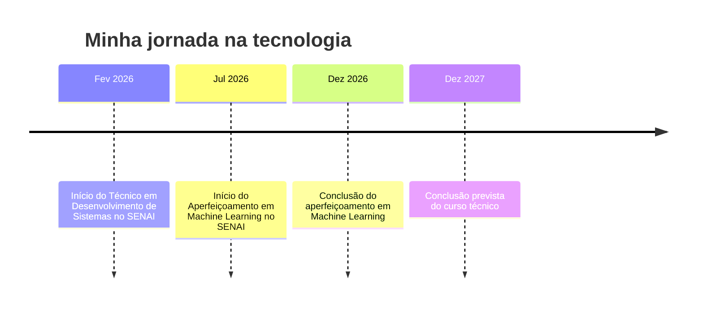

<!-- ===== CABEÇALHO ===== -->

  

  

  
  
  

  
  
  
  
  

---

## ⚡ Resumo rápido para recrutadores

| | |
|---|---|
| 👤 **Perfil** | Desenvolvedor de Sistemas em formação, Full-Stack, com foco em Front-End e Back-End |
| 🎓 **Formação** | Técnico em Desenvolvimento de Sistemas, SENAI (Fev/2026 – Dez/2027) |
| 🤖 **Aperfeiçoamento** | Machine Learning, SENAI (Jul/2026 – Dez/2026) |
| 💻 **Stack** | HTML5 · CSS3 · JavaScript · Axios · Node.js · Express · SQL · MySQL · C++ · Arduino · Git/GitHub |
| 🎯 **Busco** | Estágio ou vaga júnior em desenvolvimento de software |
| 📍 **Local** | Botucatu, SP |
| 🌎 **Idiomas** | Português (nativo) · Inglês (básico) |
| 🌐 **Currículo online** | [leonardoleaosantos2009-hub.github.io/curriculo](https://leonardoleaosantos2009-hub.github.io/curriculo/) |
| 📫 **Contato** | leonardoleaosantos2009@gmail.com |

---

## 👨‍💻 Sobre mim

Sou **Desenvolvedor de Sistemas em formação**, com foco em **Full-Stack** (HTML, CSS, JavaScript, Node.js e MySQL). Tenho experiência prática na criação de interfaces web responsivas, integração frontend/backend via Axios, desenvolvimento de APIs RESTful com CRUD completo e exclusão lógica (soft delete), além de modelagem de banco de dados, **hardware** e **Machine Learning**.

Gosto de aprender fazendo: cada projeto aqui nasceu de um conceito que estudei e quis colocar em prática. Busco uma oportunidade para **aplicar meus conhecimentos, desenvolver projetos reais e evoluir profissionalmente** na área de tecnologia.

---

## 🌐 Currículo online

Montei um site para apresentar meu currículo, com visual futurista, tema claro/escuro, projetos, competências e formulário de contato. Dá para baixar o currículo em PDF direto por lá.

  

---

## 🛠️ Tecnologias

  

  
  
  
  
  
  
  
  
  
  
  
  

| Área | Conhecimentos |
|---|---|
| 🌐 **Desenvolvimento Web** | HTML5, CSS3, JavaScript (DOM, ES6+), consumo de APIs com Axios |
| 🎨 **Front-End** | Interfaces dinâmicas, formulários interativos, estilização responsiva, feedbacks visuais |
| ⚙️ **Back-End** | Node.js, Express, API REST (CRUD completo), soft delete, middlewares, variáveis de ambiente (dotenv) |
| 🗄️ **Banco de Dados** | SQL (DDL/DML), MySQL (driver mysql2 com connection pool), Stored Procedures e Functions, modelagem relacional |
| 🧠 **Programação** | Lógica de programação, funções, estruturas condicionais e de repetição |
| 🔌 **Eletrônica** | Arduino UNO, sensores, C++ |
| 🤖 **Machine Learning** | Fundamentos (em aprendizado) |
| 🧰 **Ferramentas** | Git, GitHub, Pacote Office, hardware e configuração |

---

## 🚀 Projetos

<table>
  <tr>
    <td width="50%" valign="top">
      <h3>📦 <a href="https://github.com/leonardoleaosantos2009-hub/cadastro_produto">Sistema de Cadastro de Produtos</a></h3>
      
Aplicação Full-Stack completa para gestão de produtos. Possui interface web dinâmica com formulário interativo (HTML/CSS/JS/Axios) conectada a uma API RESTful em Node.js e Express, com persistência em banco MySQL e suporte a criação, edição, listagem e desativação lógica (soft delete).

      
    

    </td>
    <td width="50%" valign="top">
      <h3>📚 <a href="https://github.com/leonardoleaosantos2009-hub/papyro-db">Papyro — Gestão de Biblioteca</a></h3>
      
Sistema de biblioteca para alunos e professores. Banco <b>MySQL</b> com 4 tabelas relacionadas (livro, leitor, exemplar e empréstimo) e <b>API REST</b> em Node.js e Express, organizada em rotas e controladores. Validação de campos e bloqueio de ISBN duplicado. <i>Em desenvolvimento.</i>

      
   

    </td>
  </tr>
  <tr>
    <td width="50%" valign="top">
      <h3>🛒 <a href="https://github.com/leonardoleaosantos2009-hub/API-supermercado">API REST Supermercado</a></h3>
      
API para gerenciar os produtos de um supermercado, com CRUD completo (cadastrar, listar, buscar por ID, atualizar e excluir), validação de campos, códigos HTTP e persistência em arquivo JSON. <a href="https://leonardoleaosantos2009-hub.github.io/curriculo/#projetos">Teste uma simulação no meu site.</a>

      
   

    </td>
    <td width="50%" valign="top">
      <h3>🗄 <a href="https://github.com/leonardoleaosantos2009-hub/DDL-DML-">Modelagem de Banco de Dados</a></h3>
      
Criação de modelos relacionais e DER, com entidades, atributos, chaves primárias e estrangeiras, usando comandos DDL e DML no MySQL.

      
  

    </td>
  </tr>
  <tr>
    <td width="50%" valign="top">
      <h3>🅿 <a href="https://github.com/leonardoleaosantos2009-hub/Sensor-de-Estacionamento-Ultrassonico-com-Arduino">Sensor de Estacionamento</a></h3>
      
Sensor ultrassônico com Arduino UNO que mede a distância de obstáculos, programado em C++.

      
 

    </td>
    <td width="50%" valign="top">
      <h3>🚗 <a href="https://github.com/leonardoleaosantos2009-hub/Estacionamento-DB">Estacionamento DB</a></h3>
      
Banco de dados relacional em <b>MySQL</b> para gerenciar o fluxo de veículos e proprietários de um estacionamento. Usa <b>Stored Procedures</b> para cadastros, atualizações e registro de saída, e uma <b>Stored Function</b> que calcula a tarifa automaticamente (R$ 8,00 por hora ou fração). Documentado com dicionário de dados e exemplos de uso.

      
   

    </td>
  </tr>
  <tr>
    <td colspan="2" valign="top">
      <h3>🖼️ <a href="https://github.com/leonardoleaosantos2009-hub/curriculo/tree/main/galeria">Galeria de Projetos Web</a></h3>
      
Vitrine dos meus projetos com filtros por categoria, miniaturas desenhadas em CSS, layout responsivo e animações, feita só com HTML e CSS puro. <a href="https://leonardoleaosantos2009-hub.github.io/curriculo/galeria/">Abrir a galeria ao vivo.</a>

      
 

    </td>
  </tr>
</table>

<!-- Quando tiver os nomes dos repositórios, transforme os títulos em links:
     <h3>🛒 <a href="https://github.com/leonardoleaosantos2009-hub/NOME-DO-REPO">API REST Supermercado</a></h3> -->

---

## 🧭 Trajetória

---

## 🎯 Em que estou focado agora

- 🌱 Aprofundar **JavaScript** e **Back-End** (Node.js, Express e MySQL)
- 🚧 Completar o CRUD do **Papyro** (leitores, exemplares e empréstimos)
- 🔗 Integrar **front-end e back-end** em novos projetos full-stack
- 🤖 Concluir o aperfeiçoamento em **Machine Learning**
- 🇺🇸 Melhorar o **inglês técnico**

---

## 📊 Atividade no GitHub

  

---

## 🤝 Vamos conversar?

Estou aberto a **estágios, vagas júnior e projetos colaborativos**. Se o meu perfil combina com a sua empresa, será um prazer conversar.

  
  
  <!-- Se tiver LinkedIn, descomente e ajuste o link:
   -->

  

