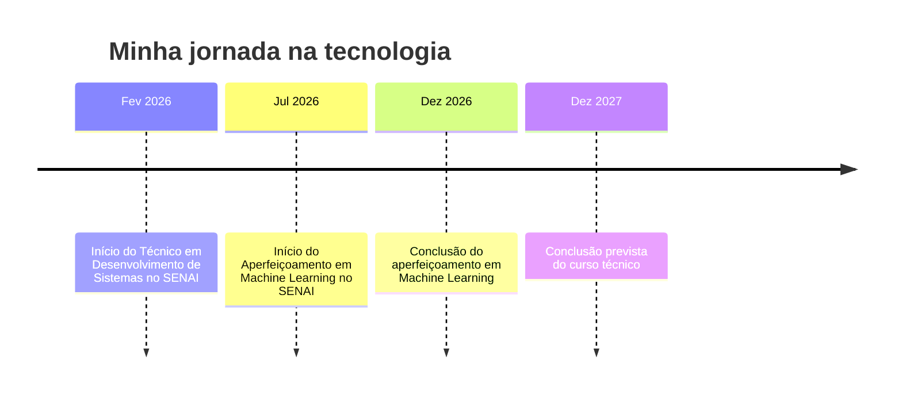

<div align="center">


<a href="https://github.com/leonardoleaosantos2009-hub">
  
</a>

<br/>

<a href="https://leonardoleaosantos2009-hub.github.io/curriculo/"></a>
<a href="mailto:leonardoleaosantos2009@gmail.com"></a>
<a href="https://github.com/leonardoleaosantos2009-hub?tab=repositories"></a>


<br/><br/>


</div>

<br/>

```js
// leonardo.js ── o mesmo código do meu site, agora no GitHub
const dev = {
  nome: "Leonardo Leão",
  local: "Botucatu, SP",
  formacao: "Téc. Desenv. de Sistemas · SENAI",
  emCurso: "Machine Learning · SENAI",
  stack: ["HTML", "CSS", "JS", "Node", "SQL", "C++"],
  idiomas: ["Português", "Inglês básico"],
  busca: "Estágio / Vaga júnior",
  aprendendo: true
};
```

---

## `> resumo_rapido --recrutadores`

| | |
|---|---|
| 👤 **Perfil** | Desenvolvedor de Sistemas em formação, Full-Stack, com foco em Front-End e Back-End |
| 🎓 **Formação** | Técnico em Desenvolvimento de Sistemas, SENAI (Fev/2026 – Dez/2027) |
| 🤖 **Aperfeiçoamento** | Machine Learning, SENAI (Jul/2026 – Dez/2026) |
| 💻 **Stack** | HTML5 · CSS3 · JavaScript · Axios · Node.js · Express · SQL · MySQL · C++ · Arduino · Git/GitHub |
| 🎯 **Busco** | Estágio ou vaga júnior em desenvolvimento de software |
| 📍 **Local** | Botucatu, SP |
| 🌎 **Idiomas** | Português (nativo) · Inglês (básico) |
| 📫 **Contato** | leonardoleaosantos2009@gmail.com |

---

## `> sobre_mim`

Sou **Desenvolvedor de Sistemas em formação**, com foco em **Full-Stack** (HTML, CSS, JavaScript, Node.js e MySQL). Tenho experiência prática na criação de interfaces web responsivas, integração frontend/backend via Axios, desenvolvimento de APIs RESTful com CRUD completo e exclusão lógica (*soft delete*), além de modelagem de banco de dados, **hardware** e **Machine Learning**.

Gosto de aprender fazendo: cada projeto aqui nasceu de um conceito que estudei e quis colocar em prática. Busco uma oportunidade para **aplicar meus conhecimentos, desenvolver projetos reais e evoluir profissionalmente** na área de tecnologia.

---

## `> tecnologias`

<div align="center">


<br/><br/>


</div>

<br/>

| Área | Conhecimentos |
|---|---|
| 🌐 **Desenvolvimento Web** | HTML5, CSS3, JavaScript (DOM, ES6+), consumo de APIs com Axios |
| 🎨 **Front-End** | Interfaces dinâmicas, formulários interativos, estilização responsiva, feedbacks visuais |
| ⚙️ **Back-End** | Node.js, Express, API REST (CRUD completo), soft delete, middlewares, variáveis de ambiente (dotenv) |
| 🗄️ **Banco de Dados** | SQL (DDL/DML), MySQL (driver mysql2 com connection pool), modelagem relacional |
| 🧠 **Programação** | Lógica de programação, funções, estruturas condicionais e de repetição |
| 🔌 **Eletrônica** | Arduino UNO, sensores, C++ |
| 🤖 **Machine Learning** | Fundamentos (em aprendizado) |
| 🧰 **Ferramentas** | Git, GitHub, VS Code, Pacote Office, hardware e configuração |

---

## `> projetos`

<table>
<tr>
<td width="50%" valign="top">

### 📦 [Sistema de Cadastro de Produtos](https://github.com/leonardoleaosantos2009-hub/cadastro_produto)
Aplicação **Full-Stack** completa para gestão de produtos. Interface web dinâmica com formulário interativo (HTML/CSS/JS/Axios) conectada a uma **API RESTful** em Node.js e Express, com persistência em **MySQL** e suporte a criação, edição, listagem e desativação lógica (*soft delete*).


</td>
<td width="50%" valign="top">

### 📚 [Papyro — Gestão de Biblioteca](https://github.com/leonardoleaosantos2009-hub/papyro-db)
Sistema de biblioteca para alunos e professores. Banco **MySQL** com 4 tabelas relacionadas (livro, leitor, exemplar e empréstimo) e **API REST** em Node.js e Express, organizada em rotas e controladores. Validação de campos e bloqueio de ISBN duplicado. *🚧 Em desenvolvimento.*


</td>
</tr>
<tr>
<td width="50%" valign="top">

### 🛒 API REST Supermercado
API para gerenciar os produtos de um supermercado, com CRUD completo (cadastrar, listar, buscar por ID, atualizar e excluir), validação de campos, códigos HTTP corretos e persistência em arquivo JSON.


</td>
<td width="50%" valign="top">

### 🗄️ [Modelagem de Banco de Dados](https://github.com/leonardoleaosantos2009-hub/DDL-DML-)
Criação de modelos relacionais e DER, com entidades, atributos, chaves primárias e estrangeiras, usando comandos DDL e DML no MySQL.


</td>
</tr>
<tr>
<td width="50%" valign="top">

### 🅿️ [Sensor de Estacionamento](https://github.com/leonardoleaosantos2009-hub/Sensor-de-Estacionamento-Ultrassonico-com-Arduino)
Sensor ultrassônico com Arduino UNO que mede a distância de obstáculos, programado em C++.


</td>
<td width="50%" valign="top">

### 🌐 Página de Vendas & Galeria Web
Interfaces web com seções, cards, botões e elementos estilizados, desenvolvidas com HTML e CSS puro.


</td>
</tr>
</table>

---

## `> github_stats`

<div align="center">


</div>

---

## `> trajetoria`



---

<div align="center">

### `> vamos_conversar?`

Estou aberto a **estágios, vagas júnior e projetos colaborativos**.

<a href="https://leonardoleaosantos2009-hub.github.io/curriculo/"></a>
<a href="mailto:leonardoleaosantos2009@gmail.com"></a>


</div>
